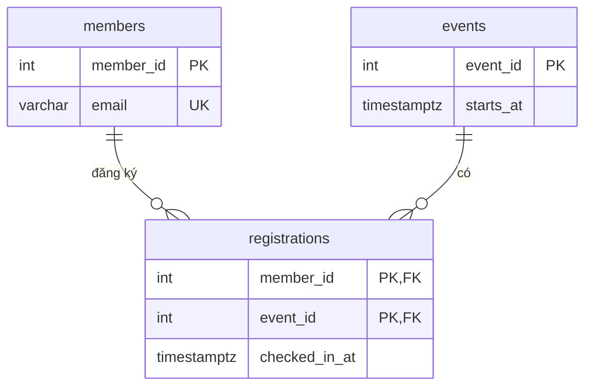

> Làm trên bộ dữ liệu DSC Shop. Tự viết và chạy truy vấn trước, sau đó mới mở **Đáp án** để so kết quả.

## 3. Dự án cuối khóa

### 3.1. Mục tiêu và hình thức

Bạn (cá nhân hoặc nhóm 2-3 người) xây dựng **từ đầu** database cho một bài toán mới, không dùng lại DSC Shop, kèm một API nhỏ dùng database đó. Thời gian gợi ý: **2 tuần**. Cuối kỳ có buổi demo 10 phút và vấn đáp 5 phút với mentor.

Mục tiêu là chứng minh bạn **vận dụng** được kiến thức, nên rubric chấm cả việc chạy đúng lẫn việc bạn giải thích được vì sao làm vậy.

### 3.2. Chọn đề tài

Chọn một trong ba đề dưới đây, hoặc tự đề xuất đề tài có độ phức tạp tương đương (cần mentor duyệt trước ngày 2).

**Đề A. Quản lý sự kiện CLB.** Thành viên, các ban trong CLB (ban có thể có ban con), sự kiện, đăng ký tham gia, check-in tại sự kiện, phân công nhân sự cho sự kiện, phản hồi sau sự kiện.

**Đề B. Thư viện CLB.** Đầu sách, bản sao (một đầu sách có nhiều cuốn), tác giả (sách nhiều tác giả), thể loại dạng cây, thành viên, phiếu mượn, gia hạn, trả trễ và tiền phạt.

**Đề C. Đặt phòng lab và thiết bị.** Phòng, thiết bị (thuộc phòng, có trạng thái), lịch đặt theo khung giờ (không được trùng lịch), người duyệt, nhật ký sự cố và sửa chữa.

Gợi ý điểm xuất phát cho Đề A, để bạn tự mở rộng (đây mới là quan hệ n-n cơ bản, chưa đủ cho dự án):



### 3.3. Yêu cầu bài nộp

Nộp một repo (hoặc thư mục nén) theo cấu trúc:

```text
du-an-cuoi-khoa/
├── README.md              mô tả đề tài, cách chạy, phân công (nếu làm nhóm)
├── docs/
│   ├── erd.png            ERD (vẽ bằng dbdiagram, draw.io, Mermaid... tùy bạn)
│   └── thiet-ke.md        giải thích chuẩn hóa và các quyết định thiết kế
├── db/
│   ├── 01_schema.sql      tạo schema, bảng, ràng buộc, index
│   ├── 02_seed.sql        dữ liệu mẫu
│   ├── 03_objects.sql     view, function/procedure, trigger
│   └── 04_security.sql    role, quyền
├── queries/
│   └── bao-cao.sql        15-20 truy vấn báo cáo, mỗi câu có chú thích câu hỏi nghiệp vụ
├── perf/
│   └── explain.md         EXPLAIN ANALYZE trước và sau khi thêm index
├── app/                   API nhỏ (Python hoặc Node.js)
└── backup/
    └── huong-dan.md       lệnh sao lưu, khôi phục và kết quả khôi phục thử
```

Yêu cầu bắt buộc theo từng phần:

1. **ERD và thiết kế.** Ít nhất 6 bảng, có ít nhất một quan hệ n-n qua bảng trung gian. `thiet-ke.md` chỉ ra các phụ thuộc hàm chính và giải thích vì sao schema đạt 3NF; nếu có chỗ cố ý phi chuẩn hóa thì nêu lý do (Ngày 27).
2. **Schema.** Đủ khóa chính, khóa ngoại (chọn `ON DELETE` có chủ đích), `NOT NULL`, `UNIQUE`, `CHECK`, `DEFAULT` hợp lý; tiền dùng `NUMERIC`, thời điểm dùng `TIMESTAMPTZ` (Ngày 2). Script chạy lại được nhiều lần (`DROP ... IF EXISTS` hoặc tạo lại schema).
3. **Dữ liệu mẫu.** Đủ để mọi truy vấn báo cáo trả về kết quả có ý nghĩa: mỗi bảng chính ít nhất 20-30 dòng, có cả NULL, dữ liệu "chưa có liên quan" (thành viên chưa đăng ký sự kiện nào...). Cho phần hiệu năng: một bảng lớn ít nhất 100.000 dòng sinh bằng `generate_series` (tham khảo `setup/perf_seed.sql`).
4. **15-20 truy vấn báo cáo.** Mỗi truy vấn trả lời một câu hỏi nghiệp vụ viết bằng tiếng Việt ở dòng chú thích. Toàn bộ phải dùng được ít nhất: JOIN 3 bảng trở lên, anti-join hoặc `NOT EXISTS`, `GROUP BY` + `HAVING`, subquery hoặc CTE, `CASE` hoặc `FILTER`, toán tử tập hợp, ít nhất 2 window function khác loại (xếp hạng, lũy kế, `LAG`...), và một CTE đệ quy nếu đề có cấu trúc cây.
5. **Transaction.** Ít nhất một nghiệp vụ nhiều bước chạy trong transaction (ví dụ: mượn sách = tạo phiếu + đổi trạng thái bản sao), có xử lý trường hợp tranh chấp (khóa dòng hoặc ràng buộc chặn trùng) và giải thích chọn isolation level nào (Ngày 16).
6. **View.** Ít nhất 2 view, trong đó một view dùng để giới hạn những cột người dùng khác được xem (Ngày 19).
7. **Function/procedure và trigger.** Ít nhất 1 function hoặc procedure có xử lý lỗi bằng `RAISE`, và 1 trigger có lý do tồn tại rõ ràng (audit log, chặn dữ liệu sai, cập nhật trạng thái). Giải thích vì sao việc đó nên đặt trong database (Ngày 17, 18).
8. **Hiệu năng.** Chọn ít nhất 2 truy vấn trên bảng lớn, ghi `EXPLAIN (ANALYZE, BUFFERS)` trước và sau khi thêm index, so sánh thời gian và kiểu scan, giải thích vì sao index giúp được (hoặc vì sao không) (Ngày 15, 20, 28).
9. **API nhỏ.** 3-5 endpoint (ví dụ: danh sách sự kiện có phân trang, đăng ký sự kiện, báo cáo top thành viên tích cực) bằng Python (psycopg) hoặc Node.js (pg). **Mọi** câu SQL dùng truy vấn tham số hóa; nghiệp vụ nhiều bước chạy trong transaction; thông tin kết nối đọc từ biến môi trường, không ghi cứng trong code (Ngày 23).
10. **Bảo mật và sao lưu.** Role riêng cho ứng dụng với quyền tối thiểu; nếu có lưu mật khẩu thì lưu hash; lệnh `pg_dump` và `pg_restore`, kèm bằng chứng đã khôi phục thử vào một database mới và so sánh số dòng (Ngày 30).

### 3.4. Lịch gợi ý

| Thời gian | Việc | Mốc kiểm tra với mentor |
| --- | --- | --- |
| Ngày 1-2 | Chọn đề, liệt kê nghiệp vụ, vẽ ERD | Mentor duyệt đề và ERD |
| Ngày 3-4 | Viết `01_schema.sql`, `02_seed.sql` | Script chạy được trên database rỗng |
| Ngày 5-7 | Viết truy vấn báo cáo | Nộp nháp 10 truy vấn đầu |
| Ngày 8-9 | Transaction, view, function, trigger, role | |
| Ngày 10-11 | Sinh dữ liệu lớn, đo `EXPLAIN`, thêm index | |
| Ngày 12-13 | API, sao lưu và khôi phục thử | |
| Ngày 14 | Hoàn thiện README, tập demo | Demo và vấn đáp |

### 3.5. Rubric chấm điểm (100 điểm)

Mỗi tiêu chí có ba mức. "Đầy đủ" nhận toàn bộ điểm, "Một phần" nhận khoảng một nửa (mentor chọn điểm trong khoảng ghi ở cột), "Chưa đạt" nhận 0.

| # | Tiêu chí | Điểm | Đầy đủ | Một phần | Chưa đạt |
| --- | --- | --- | --- | --- | --- |
| 1 | ERD và chuẩn hóa | 15 | ERD đúng ký hiệu, ≥ 6 bảng, có n-n; giải thích được phụ thuộc hàm và vì sao đạt 3NF; phi chuẩn hóa (nếu có) có lý do | 6-10: ERD có nhưng thiếu quan hệ hoặc lệch với schema; giải thích chuẩn hóa chung chung | Không có ERD, hoặc có lặp dữ liệu rõ ràng (vi phạm 2NF/3NF) mà không nhận ra |
| 2 | Schema và ràng buộc | 15 | Đủ PK, FK có `ON DELETE` chủ đích, `NOT NULL`, `UNIQUE`, `CHECK`; kiểu dữ liệu đúng (NUMERIC cho tiền, TIMESTAMPTZ); script chạy lại được | 6-10: thiếu vài ràng buộc quan trọng, hoặc sai kiểu ở 1-2 cột | Thiếu FK, dùng FLOAT cho tiền ở nhiều chỗ, script không chạy được |
| 3 | Dữ liệu mẫu | 5 | Đủ số lượng, có NULL và trường hợp biên, có bảng lớn sinh bằng `generate_series` | 2-3: dữ liệu ít, nhiều truy vấn trả về rỗng hoặc 1 dòng | Không có seed hoặc seed lỗi |
| 4 | Truy vấn báo cáo | 20 | 15-20 truy vấn chạy đúng, phủ đủ các kỹ thuật ở yêu cầu 4, mỗi câu có câu hỏi nghiệp vụ rõ, không bẫy nhân dòng hay `NOT IN` với NULL | 8-14: dưới 15 truy vấn, hoặc thiếu 2-3 kỹ thuật, hoặc 1-2 câu sai kết quả | Dưới 8 truy vấn chạy được, hoặc nhiều câu sai |
| 5 | Transaction | 8 | Nghiệp vụ nhiều bước trong transaction, xử lý tranh chấp, giải thích isolation level | 3-5: có `BEGIN/COMMIT` nhưng không xử lý tranh chấp hoặc không giải thích | Không có transaction |
| 6 | View | 5 | ≥ 2 view có ích, một view giới hạn cột nhạy cảm | 2-3: có 1 view, hoặc view chỉ là `SELECT *` | Không có view |
| 7 | Function/procedure và trigger | 8 | Function có xử lý lỗi, trigger có mục đích rõ, giải thích vì sao đặt trong database | 3-5: có một trong hai, hoặc chạy được nhưng không có xử lý lỗi | Không có hoặc không chạy được |
| 8 | Hiệu năng | 9 | ≥ 2 truy vấn có EXPLAIN ANALYZE trước/sau trên bảng ≥ 100.000 dòng, số liệu thật, giải thích đúng kiểu scan và vì sao nhanh hơn | 4-6: chỉ 1 truy vấn, hoặc đo trên bảng quá nhỏ, hoặc giải thích chưa đúng | Không đo, hoặc số liệu không có thật |
| 9 | API tham số hóa | 10 | 3-5 endpoint chạy được; 100% truy vấn tham số hóa; transaction cho nghiệp vụ nhiều bước; cấu hình qua biến môi trường | 4-6: API chạy nhưng có endpoint thiếu transaction hoặc ghi cứng mật khẩu | Có bất kỳ câu SQL ghép chuỗi từ input người dùng (lỗi SQL injection), hoặc API không chạy |
| 10 | Bảo mật và sao lưu | 5 | Role quyền tối thiểu cho ứng dụng; mật khẩu (nếu có) lưu hash; có bằng chứng khôi phục thử thành công | 2-3: có backup nhưng chưa khôi phục thử, hoặc ứng dụng dùng user `postgres` | Không có backup, hoặc lưu mật khẩu dạng rõ |

Quy ước tổng điểm:

- **Đạt:** từ 60 điểm. **Khá:** từ 75. **Giỏi:** từ 85.
- **Điều kiện bắt buộc:** `db/01_schema.sql` và `db/02_seed.sql` phải chạy được trên một database rỗng. Không chạy được thì tiêu chí 2, 3, 4 tối đa chỉ được mức "Một phần".
- **Lỗi bảo mật nghiêm trọng** (SQL ghép chuỗi từ input, mật khẩu dạng rõ, mật khẩu database commit lên repo): tiêu chí liên quan nhận 0 và bài không được xếp loại Giỏi dù đủ điểm.
- **Vấn đáp:** mentor chọn ngẫu nhiên 2 truy vấn và 1 quyết định thiết kế để hỏi. Không giải thích được phần mình nộp thì tiêu chí tương ứng hạ một mức.
- **Điểm cộng** (tối đa +5, tổng không quá 100): partition cho bảng lớn, row-level security, materialized view có lịch refresh, test tự động cho API, CI chạy script SQL.

### 3.6. Hướng dẫn cho mentor khi chấm

Để chấm nhất quán giữa các mentor:

1. Dựng database sạch và chạy script của học viên. Với môi trường Docker của khóa học:

   ```sh
   docker compose exec -T db psql -U postgres -c "DROP DATABASE IF EXISTS cham_bai" -c "CREATE DATABASE cham_bai"
   docker compose exec -T db psql -U postgres -d cham_bai -v ON_ERROR_STOP=1 < db/01_schema.sql
   docker compose exec -T db psql -U postgres -d cham_bai -v ON_ERROR_STOP=1 < db/02_seed.sql
   ```

   `ON_ERROR_STOP=1` làm psql dừng ngay ở lỗi đầu tiên, nên bạn biết chắc script có chạy trọn vẹn hay không.
2. Chạy `queries/bao-cao.sql` tương tự, đối chiếu vài kết quả với dữ liệu seed bằng cách tự đếm tay trên 1-2 câu.
3. Tìm nhanh lỗi SQL injection trong `app/`: mọi chỗ gọi `execute`/`query` mà chuỗi SQL được tạo bằng f-string, `+` hoặc template string có biến từ request.
4. Mở `perf/explain.md`: số dòng của bảng lớn có đủ không, có cả "trước" và "sau" không, kiểu scan có đổi không.
5. Ghi điểm từng tiêu chí kèm 1 câu nhận xét; nhận xét quan trọng hơn con số với người học.

---
